<p align="center">
  <a href="https://github.com/Cuixiaojian21/cfizz">
    
  </a>
</p>

<h1 align="center">cfizz</h1>

> **C**hromosome **F**low **I**ntegration with **Z**one-**T**erminal **V**isuali**z**ation

English | [简体中文](https://github.com/Cuixiaojian21/cfizz/blob/main/README.zh-CN.md)

<p align="center">
  
</p>

<p align="center">
  <b>Case study (not the bundled demo)</b><br>
  H1-hESC vs HFFc6 at the <i>MYC</i> locus (chr8:127.2–128.2 Mb, 10 kb).<br>
  3000 dpi PNG (12,992 × 23,149 px) + vector SVG (2.9 MB; heatmaps embedded at 2000 dpi).
  <a href="https://raw.githubusercontent.com/Cuixiaojian21/cfizz/main/assets/figures/myc_multi_omics_h1_hffc6_3000dpi.png">View full-resolution PNG (7 MB)</a>
</p>

cfizz is a Python library for chromatin conformation capture data (Hi-C/Micro-C). It covers the full analysis path from FASTQ preprocessing (optional reference implementation in `src/cfizz/preprocessing/`) to publication-grade figures. It provides more than a dozen standard figure templates for 3D genome analysis, rapid detection of altered features, multi-omics integration, and a companion LLM-based plotting agent ([cfizz-agent](https://github.com/peiheng-jia/cfizz-agent)) for adjusting figures with natural language.

## Core features

- **End-to-end workflow**: from FASTQ through fastp / bwa-mem2 / pairtools / cooler to `.mcool`, then Compartment, TAD and Loop analysis, altered-feature detection, and figure generation.
- **Visualization templates**: more than a dozen standard 3D-genome figure types (heatmaps, multi-sample comparisons, Compartment, TAD, Loop, Saddle, APA, TAD pileup, distance decay, multi-omics integration, etc.), with publication-grade typography, physical sizing (cm), and high-dpi output.
- **Altered-feature detection**: match and classify Compartment, TAD boundary and Loop features to locate regions that change between samples.
- **Multi-omics integration**: place Hi-C, ATAC, ChIP-Seq/CUT&Tag, RNA-Seq BigWig tracks and GTF/BED annotations in the same coordinate system to inspect signal associations around altered features.
- **LLM-based plotting agent**: the companion `cfizz-agent` repository lowers the barrier to figure tuning through natural-language instructions.

## Table of contents

- [Installation](#installation)
- [Quick start](#quick-start)
- [Pipeline overview](#pipeline-overview)
- [Examples](#examples)
  - [5_0 Distance decay](#5_0-distance-decay)
  - [5_1 Primary analysis](#5_1-primary-analysis)
  - [5_2 Primary analysis visualization](#5_2-primary-analysis-visualization)
  - [5_3 Pileup analysis](#5_3-pileup-analysis)
  - [6_1 Altered-feature computation](#6_1-altered-feature-computation)
  - [6_2 Altered-feature visualization](#6_2-altered-feature-visualization)
  - [6_3 Altered-feature pileup](#6_3-altered-feature-pileup)
  - [7_1 Multi-omics integration](#7_1-multi-omics-integration)
  - [7_2 / 7_3 Extended examples](#7_2--7_3-extended-examples)
- [Case study](#case-study)
- [Demo data](#demo-data)
- [Demo outputs and full run order](#demo-outputs-and-full-run-order)
- [API overview](#api-overview)
- [Input data and reference files](#input-data-and-reference-files)
- [Upstream preprocessing](#upstream-preprocessing)
- [Project structure](#project-structure)
- [FAQ](#faq)
- [Citation, contributing and license](#citation-contributing-and-license)

## Installation

cfizz requires **Python ≥ 3.9**. We recommend creating a micromamba (or conda) environment and installing the package with pip.

### 1. Create a conda environment

```bash
git clone https://github.com/Cuixiaojian21/cfizz.git
cd cfizz

micromamba env create -f environment.yml
micromamba activate cfizz
```

`environment.yml` uses Python 3.12 and includes cooler, cooltools, bioframe, samtools, pairtools and related dependencies.

### 2. Install pip-only dependencies

```bash
pip install -r requirements.txt
```

`requirements.txt` contains `hicpeaks` (provides the `pyHICCUPS` CLI required for Loop calling) and `adjustText` (optional text-collision avoidance for plots).

### 3. Install cfizz

```bash
pip install -e .
```

For BigWig support (7_x multi-omics figures), install the optional extras:

```bash
pip install -e ".[all]"
```

### Verify the installation

```bash
# cfizz itself
python -c "import cfizz; print('cfizz', cfizz.__version__)"

# core dependencies
python -c "import cooler, cooltools; print('core deps ok')"

# BigWig support (optional)
python -c "import pyBigWig; print('bigwig ok')"

# Loop calling (needed by 5_1)
which pyHICCUPS && pyHICCUPS --version
```

> When running directly from a source checkout, scripts under `examples/` add `src/` to `sys.path`, so an editable install is not strictly required. For regular use, `pip install -e .` is recommended.

## Quick start

The shortest end-to-end example is `5_0` distance decay. It only reads the two demo `.mcool` files.

```bash
cd cfizz
python examples/5_0_distance_decay_comparison.py
```

It finishes in about 13 seconds on a 4-core machine and writes:

```text
demo/output/5_0_distance_decay_comparison/7_distance_decay/
├── distance_decay_loglog.png
├── distance_decay_loglog.svg
├── distance_decay_alpha.tsv
├── distance_decay_comparison.tsv
└── distance_decay_data.tsv
```

## Pipeline overview

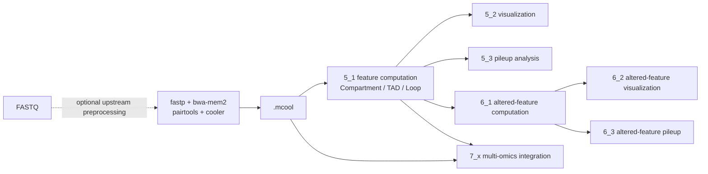

Numbering convention:

- **5_x**: primary analysis (feature computation, visualization, pileup analysis).
- **6_x**: altered-feature analysis (computation, visualization, pileup). Code and file names still use `differential` / `diff`; the documentation uses "altered feature".
- **7_x**: Zone-Terminal multi-omics integration.

## Examples

All commands below are run from the repository root. Demo data lives in `demo/data/`; examples write to `demo/output/` by default.

### 5_0 Distance decay

Compute P(s) distance-decay curves for two samples, fit the power-law exponent α, and compare the samples.

- **Input**: `demo/data/hiPSC_{var,nor}_chr17.mcool`
- **Key parameters**: 10 kb resolution, maximum distance 50 Mb, fit window 0.2–5 Mb, `balance=False`, 4 processes
- **Outputs**: log-log curves (PNG/SVG), α table, sample comparison table, and the full P(s) data

```bash
python examples/5_0_distance_decay_comparison.py
```

Production data usually uses a 200 Mb maximum distance and a 0.5–5 Mb fit window; these parameters are set at the top of the script.

<p align="center">
  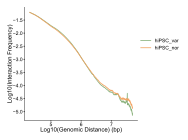
</p>

### 5_1 Primary analysis

Compute three feature classes from `.mcool` files:

| Feature | Resolution | Method | Main outputs |
|---|---|---|---|
| Compartment | 100 kb | arm-level eigen decomposition + GC correction + QC | `eigenvector.*.100k.tsv`, `gc_cov.100k.tsv`, `compartment_qc.*.tsv` |
| TAD | 10 kb | insulation + Otsu threshold + 3 windows (50/100/500 kb) | `*.insulation.tsv`, `*.boundaries.tsv`, `*.tads.tsv` |
| Loop | 10 kb | `pyHICCUPS` | `*.10k.loops.txt` (BEDPE coordinates + HiCCUPS statistics) |

- **Input**: two demo `.mcool` files; an hg38 FASTA is recommended (the example reads it from `CFIZZ_FASTA`; when calling the library directly with `fasta_path=None`, GC is set to 0.5)
- **Output directory**: `demo/output/5_1_primary_analysis_template/1_computation/`

```bash
export CFIZZ_FASTA=/path/to/hg38.fa
python examples/5_1_primary_analysis_template.py
```

Notes:

- Compartment analysis defaults to `view="arm"` and splits chromosomes into p/q arms at the UCSC cytoBandIdeo centromere. Source checkouts and editable installs automatically look for `demo/data/hg38.cytoBand.ideo.txt.gz`; for regular installs or when the file is absent, set `CFIZZ_CYTOBAND`, otherwise cfizz falls back to whole-chromosome view.
- Loop calling requires `pyHICCUPS`.
- Hi-C analysis is CPU-, memory- and disk-intensive; run it on a server or compute node. The example uses `NPROC=26`; adjust it for your machine.

#### Starting from FASTQ (optional)

If you only have FASTQ files, run the upstream preprocessing under `src/cfizz/preprocessing/` first:

```text
FASTQ → fastp → bwa-mem2 → pairtools → cooler → .mcool → 5_1
```

The scripts are `fastq2pairs.sh`, `pairs2mcool.sh` and `stats.py`; see [`src/cfizz/preprocessing/README.md`](https://github.com/Cuixiaojian21/cfizz/blob/main/src/cfizz/preprocessing/README.md) for parameters and examples. If you already have `.mcool` files, skip this step.

### 5_2 Primary analysis visualization

Visualize the 5_1 outputs in four blocks (single-sample, multi-sample, and quick_plot combinations):

| Block | Region | Resolution | Output |
|---|---|---|---|
| Heatmap | chr17:10–12 Mb | 10 kb | single sample + multi + `quick_plot_integrated` |
| Compartment | chr17 0–83 Mb (demo coverage) | 100 kb | single sample + multi |
| TAD | chr17:10–12 Mb | 10 kb | single sample + multi (100 kb insulation overlay) |
| Loop | chr17:10–12 Mb | 10 kb | single sample + multi + `quick_plot_integrated` |

Common interfaces (the snippets assume `samples` and `loop_paths` are defined):

```python
from cfizz.viz.heatmap import generate_multi_heatmap
from cfizz.viz.loop import plot_multi_heatmap_with_loops
from cfizz.api.integrated import quick_plot_integrated, GenomeRange

# Multi-sample heatmap
generate_multi_heatmap(
    file_paths=list(samples.values()),
    sample_names=list(samples.keys()),
    chrom="chr17", resolution=10_000,
    start_pos=10_000_000, end_pos=12_000_000,
    output_dir="demo/output/.../heatmap/multi",
    balance=False, cmap="Reds",
)

# Multi-sample Loop annotation
plot_multi_heatmap_with_loops(
    mcool_paths=list(samples.values()),
    loops_paths=list(loop_paths),
    output_path="demo/output/.../loop/multi/loops_multi",
    sample_names=list(samples.keys()),
    chrom="chr17", start=10_000_000, end=12_000_000,
    resolution=10_000, loop_color="blue", loop_size=8,
    plot_size=4,
)

# Quick heatmap (for TAD/Loop overlays, add
# insulation_path / window_size / loops_path to each hic dict)
quick_plot_integrated(
    hics=[{"file": p, "name": n, "balance": False,
           "resolution": 10_000, "triangle_ratio": 1.0}
          for n, p in samples.items()],
    region=GenomeRange("chr17", 10_000_000, 12_000_000),
    output="demo/output/.../loop/quick_plot_integrated/quick_plot_integrated",
    n_tracks=0, width_cm=6, dpi=3000,
)
```

```bash
python examples/5_2_primary_analysis_visualization.py
```

<p align="center">
  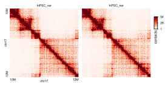
</p>

<p align="center"><sub>Heatmap multi (chr17:10–12 Mb, 10 kb)</sub></p>

<p align="center">
  
</p>

<p align="center"><sub>Compartment multi (chr17:0–83 Mb, 100 kb)</sub></p>

<p align="center">
  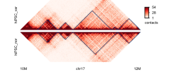
</p>

<p align="center"><sub>TAD multi (chr17:10–12 Mb, blue boundaries)</sub></p>

<p align="center">
  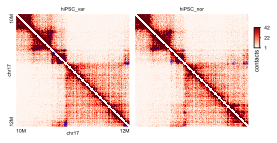
</p>

<p align="center"><sub>Loop multi (chr17:10–12 Mb, blue annotations)</sub></p>

### 5_3 Pileup analysis

Generate four classes of pileup figures from 5_1 outputs (three figures per class: two samples plus multi):

| Analysis | Input | Key parameters | Output |
|---|---|---|---|
| Saddle | 5_1 eigenvector | 100 kb, `n_bins=98`, vmin/vmax=±1 | `saddle/*/` |
| TAD linear | 5_1 boundaries | 10 kb, flank 300 kb, top 1000, mean | `tad_pileup/*/` |
| TAD O/E | boundaries + per-sample P(s) | `log2(obs/exp)`, coolwarm, ±1 | `tad_oe_pileup/*/` |
| APA O/E | 5_1 loops + per-sample P(s) | median, linear, flank 70 kb, 0.5–2.0 | `apa_oe/*/` |

The figures below show Saddle, TAD O/E and APA O/E; TAD linear is in `tad_pileup/`.

Common interfaces (the snippets assume `samples`, `boundaries_a/b` and `loops_a/b` are defined):

```python
from cfizz.viz.pileup import plot_multi_tad_boundary_pileup
from cfizz.analyze.oe import compute_expected_cis_per_sample
from cfizz.api.integrated.apa_pileup import compute_apa_oe_pileup_multi

# TAD O/E pileup
expected = compute_expected_cis_per_sample(samples, resolution=10_000, nproc=8)
plot_multi_tad_boundary_pileup(
    mcool_paths=list(samples.values()),
    boundaries_list=[boundaries_a, boundaries_b],
    expected_dfs=expected,
    output_path="demo/output/.../tad_oe_pileup/multi/tad_oe_pileup_multi",
    sample_names=list(samples.keys()),
    flank=300_000, resolution=10_000,
    color_scale="log2", cmap="coolwarm", vmin=-1, vmax=1,
    method="mean", balance=True,
)

# APA O/E
compute_apa_oe_pileup_multi(
    mcool_paths=list(samples.values()),
    loops_paths=[loops_a, loops_b],
    expected_dfs=expected,
    output_path="demo/output/.../apa_oe/multi/apa_oe_multi",
    sample_names=list(samples.keys()),
    flank=70_000, resolution=10_000,
    method="median", color_scale="linear",
    cmap="coolwarm", vmin=0.5, vmax=2.0,
    cbar_label="median obs/exp",
)
```

```bash
python examples/5_3_primary_analysis_pileup.py
```

<p align="center">
  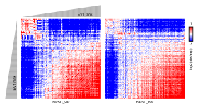
</p>

<p align="center">
  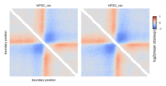
</p>

<p align="center">
  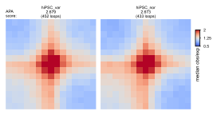
</p>

### 6_1 Altered-feature computation

Compare two samples across three feature classes using 5_1 outputs. The core idea is **proximity matching plus threshold classification**, not ortholog-style matching:

- **Compartment**: merge on `chrom/start/end` → `Stable_A` / `Stable_B` / `A_to_B` / `B_to_A`
- **TAD boundaries**: one-dimensional bidirectional KDTree pairing → `Stable_boundary` / `Boundary_shift` / `Unique_boundary`
- **Loops**: pre-filter with HiCCUPS `q_product < 0.01`, then two-dimensional anchor KDTree matching → `Stable` / `Unique` (`Unique` means sample-specific, i.e. gain / lost)

> Code and file names still use `differential` / `diff`; this documentation uses "altered feature".

Output directory:

```text
demo/output/5_1_primary_analysis_template/4_differential/hiPSC_var--hiPSC_nor/
├── compartment/
│   ├── compartment_hiPSC_var--hiPSC_nor_diff.tsv
│   ├── compartment_hiPSC_var--hiPSC_nor_scatter.png/svg
│   └── compartment_plot_data.tsv
├── tad_boundary/{5b,10b,50b}/
│   ├── hiPSC_var_vs_hiPSC_nor_boundary_classification_final.tsv
│   ├── hiPSC_var_vs_hiPSC_nor_{window}_pairing1/2.tsv
│   ├── tad_hiPSC_var_hiPSC_nor_{window}_stacked_bar.png/svg
│   └── tad_plot_data.tsv
└── loops/
    ├── 1_1_hiPSC_var_unique_loops.tsv
    ├── 1_1_hiPSC_nor_unique_loops.tsv
    ├── 1_1_hiPSC_var_stable_loops.tsv
    ├── 1_1_hiPSC_nor_stable_loops.tsv
    ├── hiPSC_var_pairing.tsv
    ├── hiPSC_nor_pairing.tsv
    ├── loops_hiPSC_var_hiPSC_nor_stacked_bar.png/svg
    └── loops_plot_data.tsv
```

```python
from cfizz.analyze.compartment import analyze_single_comparison

analyze_single_comparison(
    comparison="hiPSC_var--hiPSC_nor",
    output_root="demo/output/.../4_differential/hiPSC_var--hiPSC_nor",
    run_mode="all",                 # all / compute / plot
    control_e1_path=control_eig,
    treatment_e1_path=treatment_eig,
)
```

```bash
python examples/diff/6_1_differential_compute.py
```

<p align="center">
  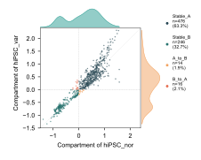
</p>

<p align="center">
  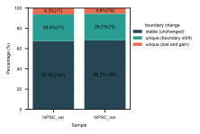
</p>

<p align="center">
  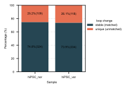
</p>

### 6_2 Altered-feature visualization

Read 6_1 results and render individual altered regions:

- **Compartment**: `A_to_B` / `B_to_A`, reusing the 5_2 O/E matrix (demo is chr17 only)
- **TAD**: `Unique_boundary` / `Boundary_shift`, 3 windows
- **Loop**: `gain` / `lost` (from 6_1 `Unique` loops), one loop per figure
- At most 5 figures per class (`MAX_PER_TYPE`)

```text
4_differential/hiPSC_var--hiPSC_nor/viz/
├── compartment/{A_to_B,B_to_A}/
├── tad_boundary/{5b,10b,50b}/{Unique_boundary,Boundary_shift}/
└── loops/{gain,lost}/
```

```bash
python examples/diff/6_2_differential_visualization.py
```

<p align="center">
  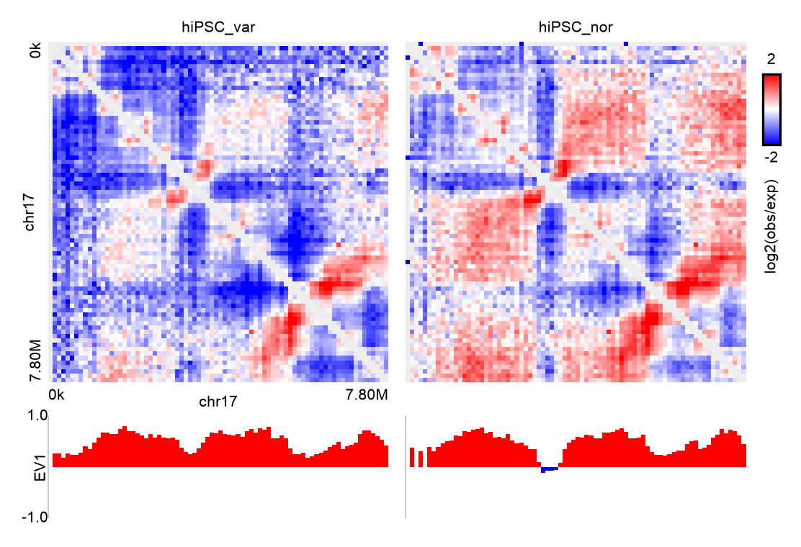
</p>

<p align="center"><sub>B_to_A example: chr17:0–7.8 Mb (strong change)</sub></p>

<p align="center">
  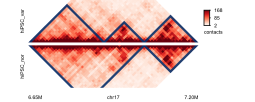
</p>

<p align="center">
  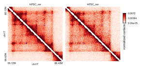
</p>

### 6_3 Altered-feature pileup

Compare 6_1 altered loops and boundaries across both samples:

- **Loop APA**: the same `gain` or `lost` loops are piled up on both samples as O/E APA (median + linear)
- **TAD pileup**: the same altered boundaries are piled up on both samples as O/E pileup (log2 + coolwarm), windows 5b/10b/50b
- **Publication settings**: 4 cm per panel, 3000 dpi; APA uses median + linear, TAD uses log2 + coolwarm

```text
4_differential/hiPSC_var--hiPSC_nor/viz/
├── loops_apa/{gain,lost}/loops_apa_*.png/svg
└── tad_pileup/{gain,lost}/{5b,10b,50b}/tad_pileup_*.png/svg
```

```bash
python examples/diff/6_3_differential_pileup.py
```

<p align="center">
  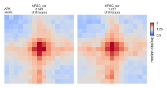
</p>

<p align="center">
  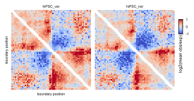
</p>

### 7_1 Multi-omics integration

Single-gene multi-omics figure: Hi-C + GTF + enhancer BED + 8 BigWig tracks.

- **Region**: chr17:75,400,000–76,340,000 (940 kb)
- **Gene**: FOXJ1
- **Tracks**: GTF → enhancer BED → ATAC × 2 → H3K27ac × 2 → CTCF × 2 → RNA × 2
- **Output**: `demo/output/7_1_multi_omics_integrated/`

```bash
python examples/integrated/7_1_multi_omics_integrated.py
```

The core interface is `quick_plot_integrated`:

```python
from cfizz.api.integrated import quick_plot_integrated, GenomeRange

quick_plot_integrated(
    hics=[
        {"file": "sample_a.mcool", "name": "A", "balance": True,
         "resolution": 10_000, "triangle_ratio": 1.0,
         "insulation_path": "tad/1_0.sample_a.10000.insulation.tsv",
         "window_size": 100_000},
        {"file": "sample_b.mcool", "name": "B", "balance": True,
         "resolution": 10_000, "triangle_ratio": 1.0,
         "flip_vertical": True,
         "loops_path": "loops/sample_b.10k.loops.txt"},
    ],
    tracks=[
        {"file": "genes.gtf", "gtf_style": "flybase", "labels": True},
        {"file": "enhancers.bed", "color": "purple", "name": "Enhancers"},
        {"file": "CTCF.bw", "color": "#264653", "name": "CTCF"},
        {"file": "RNA.bw", "color": "#E76F51", "name": "RNA"},
    ],
    region=GenomeRange("chr8", 127_235_000, 128_243_000),
    output="out/figure",
    width_cm=6,
    dpi=3000,
)
```

<p align="center">
  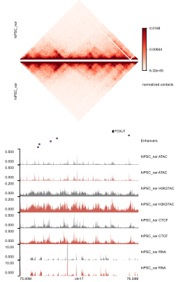
</p>

### 7_2 / 7_3 Extended examples

- `examples/integrated/7_2_log2_tracks.py`: replaces the last two tracks (RNA × 2) with log2 fold-change tracks (ATAC, RNA) to show altered signal.
- `examples/integrated/7_3_multi_gene.py`: replaces the single-gene GTF with a merged GTF of 19 genes to show a multi-gene region.

Both use the same demo data as 7_1:

```bash
python examples/integrated/7_2_log2_tracks.py
python examples/integrated/7_3_multi_gene.py
```

## Case study

The figure at the top of this README is generated from real data to show cfizz on a complete dataset. It is **not** an output of the bundled demo.

- **Data**: H1-hESC vs HFFc6 (4DN)
- **Locus**: chr8:127,235,000–128,243,000 (*MYC* region, 10 kb)
- **Content**: half-triangle Hi-C for both samples, TAD boundaries, loop arcs, GTF for 7 genes, H1ESC enhancer BED, and 5 assay classes × 2 samples (CTCF / ATAC / H3K27ac / H3K4me3 / RNA)
- **Output**: 3000 dpi PNG (12,992 × 23,149 px, 7.0 MB) + vector SVG (2.9 MB; heatmaps embedded at 2000 dpi); layout parameter `width_cm=8`, adjustable
- **Hi-C accessions**: H1-hESC `4DNFI82R42AD`, HFFc6 `4DNFIAVXXO55`
- **Notes**: generated by the production script used for the accompanying manuscript; the full data manifest and reproduction instructions will be added at submission

The bundled demo uses a small chr17 dataset (15 MB, shallow coverage, weak changes) to let users run the pipeline quickly, not to demonstrate biological contrast. The README keeps the two layers separate:

- **Examples**: based entirely on the demo data and directly reproducible.
- **Case study**: based on real data, showing the tool on a complete dataset.

## Demo data

`demo/data/` contains about 15 MB:

```text
demo/data/
├── hiPSC_nor_chr17.mcool        # 5.8 MB, 10 kb + 100 kb
├── hiPSC_var_chr17.mcool        # 5.9 MB, 10 kb + 100 kb
├── 19 single-gene GTF files     # FOXJ1 and others
├── concordant_enhancer.chr17_75.4-76.34M.bed
├── 8 sample BigWig files        # ATAC / H3K27ac / CTCF / RNA × 2
├── 2 log2 BigWig files          # ATAC / RNA change tracks
└── hg38.cytoBand.ideo.txt.gz    # compartment arm view
```

The demo is intended to:

- run all examples quickly on a workstation or CI;
- provide shallow coverage and weak changes, not a benchmark for sensitivity or biological conclusions;
- point users to the case study for real-data results.

## Demo outputs and full run order

```text
demo/output/
├── 5_0_distance_decay_comparison/
│   └── 7_distance_decay/
├── 5_1_primary_analysis_template/
│   ├── 1_computation/           # 5_1
│   ├── 2_visualization/         # 5_2
│   ├── 3_pileup/                # 5_3
│   └── 4_differential/          # 6_x
├── 7_1_multi_omics_integrated/  # 7_1
├── 7_2_log2_tracks/             # 7_2
└── 7_3_multi_gene/              # 7_3
```

Recommended order:

```bash
# 1. Distance decay (independent)
python examples/5_0_distance_decay_comparison.py

# 2. Primary analysis (5_2 / 5_3 / 6_x depend on it)
export CFIZZ_FASTA=/path/to/hg38.fa
python examples/5_1_primary_analysis_template.py

# 3. Primary analysis visualization
python examples/5_2_primary_analysis_visualization.py

# 4. Primary analysis pileup
python examples/5_3_primary_analysis_pileup.py

# 5. Altered-feature computation
python examples/diff/6_1_differential_compute.py

# 6. Altered-feature visualization
python examples/diff/6_2_differential_visualization.py

# 7. Altered-feature pileup
python examples/diff/6_3_differential_pileup.py

# 8. Multi-omics integration (independent)
python examples/integrated/7_1_multi_omics_integrated.py

# 9. Extended multi-omics examples (optional)
python examples/integrated/7_2_log2_tracks.py
python examples/integrated/7_3_multi_gene.py
```

Dependencies:

- `5_1` is required by `5_2`, `5_3` and `6_1`; `6_2` / `6_3` depend on `6_1`.
- `6_2` also needs the 5_2 O/E matrix; the demo only contains chr17.
- `5_1` recommends a FASTA for Compartment; Loop calling needs `pyHICCUPS`.
- `7_x` refers to `7_1` / `7_2` / `7_3` in this repository; they only read demo data and do not depend on 5_1 outputs.
- `7_2` / `7_3` write to `demo/output/7_2_log2_tracks/` and `demo/output/7_3_multi_gene/` after running.

## API overview

| Module | Purpose | Representative functions |
|---|---|---|
| `cfizz.analyze.compartment` | Compartment computation and altered features | `process_compartment`, `analyze_single_comparison` |
| `cfizz.analyze.tad` | TAD computation and altered features | `process_tads`, `analyze_single_comparison_window` |
| `cfizz.analyze.loop` | Loop computation and altered features | `process_loops`, `analyze_single_comparison_loops` |
| `cfizz.analyze.oe` | O/E and expected values | `calculate_oe_matrix`, `compute_expected_cis_per_sample`, `load_or_compute_oe_matrix` |
| `cfizz.analyze.distance` | Distance decay | `compute_distance_decay_per_sample`, `fit_decay_alpha_segments` |
| `cfizz.viz.heatmap` | Heatmaps | `generate_heatmap`, `generate_multi_heatmap`, `plot_multi_heatmap` |
| `cfizz.viz.compartment` | Compartment plots | `plot_compartment`, `generate_multi_compartment` |
| `cfizz.viz.loop` | Loop plots | `plot_heatmap_with_loops`, `plot_multi_heatmap_with_loops` |
| `cfizz.viz.pileup` | Pileup plots | `plot_multi_tad_boundary_pileup`, `plot_multi_pileup` |
| `cfizz.viz.distance_decay_plot` | Distance-decay plots | `run_distance_decay`, `plot_distance_decay_curves` |
| `cfizz.api.integrated.quick_plot` | Integrated figures | `quick_plot_integrated` |
| `cfizz.api.integrated.saddle_plot` | Saddle plots | `generate_single_saddle`, `generate_multi_saddle` |
| `cfizz.api.integrated.apa_pileup` | APA | `plot_multi_apa_heatmap`, `compute_apa_oe_pileup_single`, `compute_apa_oe_pileup_multi` |
| `cfizz.io` | Data reading | `read_cooler`, `extract_contact_matrix`, `read_loops_bedpe`, `read_tads_bed` |
| `cfizz.utils` | Coordinate and interval utilities | `calc_symmetric_range`, `calc_smart_union_range`, `calc_anchor_range`, `make_loop_region_id` |
| `cfizz.preprocessing` | Optional upstream preprocessing | `fastq2pairs.sh`, `pairs2mcool.sh`, `stats.py` |

See the function docstrings for the full parameter list and defaults. The README keeps only common parameters so it stays aligned with the code.

## Input data and reference files

| Input | Format | Purpose | Bundled? |
|---|---|---|---|
| Hi-C matrix | `.mcool` with required resolutions | all 5_x / 6_x / 7_x | ✅ chr17 subset in demo |
| Reference genome | `.fa` (with `.fai` recommended) | Compartment GC correction | ❌ user-provided |
| Chromosome sizes | `chrom.sizes` | upstream preprocessing | ❌ user-provided |
| cytoBandIdeo | `.txt.gz` | Compartment arm view | ✅ bundled in demo |
| GTF | `.gtf` | gene tracks, multi-omics | ✅ single-gene GTFs in demo |
| BED | `.bed` | enhancer / ChromHMM tracks | ✅ bundled in demo |
| BigWig | `.bw` | ATAC / ChIP / RNA tracks | ✅ chr17 subset in demo |

Environment variables:

- `CFIZZ_FASTA`: reference genome path used by 5_1.
- `CFIZZ_CYTOBAND`: cytoBandIdeo path for Compartment arm view. Source checkouts and editable installs try `demo/data/hg38.cytoBand.ideo.txt.gz`; regular installs should set it explicitly, otherwise cfizz falls back to whole-chromosome view.

## Upstream preprocessing

`src/cfizz/preprocessing/` provides three parameterized scripts for going from FASTQ to a balanced `.mcool`:

| Script | Input | Output |
|---|---|---|
| `fastq2pairs.sh` | R1/R2 FASTQ | `*.nodups.UU.pairs.gz` |
| `pairs2mcool.sh` | filtered pairs | multi-resolution `.mcool` |
| `stats.py` | pairtools stats | processing-yield table |

These scripts are thin wrappers around fastp / bwa-mem2 / pairtools / cooler, not a required workflow. Users who already have `.mcool` files can skip them. See [`src/cfizz/preprocessing/README.md`](https://github.com/Cuixiaojian21/cfizz/blob/main/src/cfizz/preprocessing/README.md) for parameters and examples.

## Project structure

```text
cfizz/
├── assets/
│   ├── branding/                   # logo and social preview
│   └── figures/                    # README figures
├── demo/
│   ├── data/                       # 15 MB demo input
│   └── output/                     # demo outputs
├── examples/
│   ├── 5_0_distance_decay_comparison.py
│   ├── 5_1_primary_analysis_template.py
│   ├── 5_2_primary_analysis_visualization.py
│   ├── 5_3_primary_analysis_pileup.py
│   ├── diff/
│   │   ├── 6_1_differential_compute.py
│   │   ├── 6_2_differential_visualization.py
│   │   └── 6_3_differential_pileup.py
│   └── integrated/
│       ├── 7_1_multi_omics_integrated.py
│       ├── 7_2_log2_tracks.py
│       └── 7_3_multi_gene.py
├── src/cfizz/
│   ├── analyze/                    # compartment / tad / loop / oe / distance
│   ├── api/integrated/             # quick_plot / saddle / APA / tracks
│   ├── io/                         # cooler / BED / GTF / BigWig / paths
│   ├── preprocessing/              # optional upstream scripts
│   ├── utils/                      # coordinates / intervals / BEDPE
│   ├── viz/                        # heatmap / compartment / TAD / loop / pileup
│   └── config.py
├── environment.yml
├── requirements.txt
├── pyproject.toml
├── README.md                       # English main document
├── README.zh-CN.md                 # Simplified Chinese version
├── CONTRIBUTING.md
├── CONTRIBUTING.zh-CN.md
└── LICENSE
```

## FAQ

**5_1 says the FASTA file is missing.**

Set `CFIZZ_FASTA=/path/to/hg38.fa`, or edit `FASTA_PATH` at the top of the script. The example uses the placeholder `/path/to/hg38.fa` and will fail if it is not set. When calling the library directly with `fasta_path=None`, cfizz sets GC to 0.5 and continues, but GC correction for Compartment is disabled.

**The Loop step in 5_1 fails.**

Loop calling depends on `pyHICCUPS`. Run `pip install hicpeaks` and confirm that `which pyHICCUPS` prints a path. If you only need Compartment and TAD, comment out the Loop step.

**Compartment is not split by chromosome arm.**

Arm view needs cytoBandIdeo. Source checkouts and editable installs try `demo/data/hg38.cytoBand.ideo.txt.gz`; regular installs should set `CFIZZ_CYTOBAND`, otherwise cfizz falls back to whole-chromosome view.

**The demo figures show weak changes.**

This is intentional: the demo contains only chr17, 15 MB, with shallow coverage. It is designed for quick reproduction, not biological conclusions. See the [case study](#case-study) for real-data results.

**How do I produce 3000 dpi publication figures?**

Set `dpi=3000` for PNG. Physical size is controlled with `width_cm` / `height_cm`. Heatmaps inside SVG are embedded rasters; the default is `svg_dpi=1000`, and `quick_plot_integrated` accepts `svg_dpi`. Note that `imshow`-based figures (such as Compartment) are limited by the matrix resolution; increasing dpi does not add real pixels. PNG or vector output is better for those figures.

**Not enough memory or CPU?**

Reduce `NPROC` from 26 to 4–8. Larger datasets and finer resolutions require more memory.

## Citation, contributing and license

- **Citation**: the accompanying manuscript is in preparation. For now, cite the repository: `https://github.com/Cuixiaojian21/cfizz`. The full accession list for the case study will be added at submission.
- **Contributing**: see [`CONTRIBUTING.md`](https://github.com/Cuixiaojian21/cfizz/blob/main/CONTRIBUTING.md) for the development environment, code style, example conventions and PR workflow.
- **License**: MIT. See [`LICENSE`](https://github.com/Cuixiaojian21/cfizz/blob/main/LICENSE).
