# cfizz

> **C**hromosome **F**low **I**ntegration with **Z**one-**T**erminal **V**isuali**z**ation
> 染色体流整合与区段末端可视化

[English](README.md) | 简体中文

> 简体中文版。英文主文档见 [README.md](README.md)。

<p align="center">
  
</p>

<p align="center">
  <b>案例展示（非内置 demo）</b><br>
  H1-hESC vs HFFc6，<i>MYC</i> 位点（chr8:127.2–128.2 Mb，10 kb）。<br>
  3000 dpi PNG（12,992 × 23,149 px）+ 矢量 SVG（2.9 MB，热图内嵌 2000 dpi 栅格）。
  <a href="assets/figures/myc_multi_omics_h1_hffc6_3000dpi.png">查看全分辨率 PNG（7 MB）</a>
</p>

cfizz 是一个面向染色质构象捕获（Hi-C/Micro-C）数据的 Python 库，覆盖从 FASTQ 预处理（`src/cfizz/preprocessing/`，可选参考实现）到出版级图表的完整分析链路。它提供十余种三维基因组分析中常用的出图范式、变化特征（altered feature）的快速检测、多组学整合可视化，并配套一个基于 LLM 的绘图 Agent（[cfizz-agent](https://github.com/peiheng-jia/cfizz-agent)），用于通过自然语言完成图表调整。

## 核心特性

- **端到端流程**：从 FASTQ 开始，经 fastp / bwa-mem2 / pairtools / cooler 生成 `.mcool`，再完成 Compartment、TAD、Loop 计算、变化特征分析与出图。
- **可视化范式**：内置十余种三维基因组常用图型（热图、多样本对比、Compartment、TAD、Loop、Saddle、APA、TAD pileup、距离衰减、多组学整合等），并提供出版级字体、物理尺寸（cm）与高 dpi 输出方案。
- **变化特征检测**：对 Compartment、TAD 边界、Loop 做匹配与分类，快速定位样本之间发生改变的位置。
- **多组学整合**：将 Hi-C 与 ATAC、ChIP-Seq/CUT&Tag、RNA-Seq 等 BigWig，以及 GTF/BED 注释放在同一坐标系中，便于查看变化特征附近的信号关联。
- **基于 LLM 的绘图 Agent**：配套独立仓库 `cfizz-agent`，通过自然语言调整出图参数，降低分析和出图门槛。

## 目录

- [安装](#安装)
- [快速开始](#快速开始)
- [流水线总览](#流水线总览)
- [示例](#示例)
  - [5_0 距离衰减](#5_0-距离衰减)
  - [5_1 常规分析](#5_1-常规分析)
  - [5_2 常规分析可视化](#5_2-常规分析可视化)
  - [5_3 累计分析](#5_3-累计分析)
  - [6_1 变化特征计算](#6_1-变化特征计算)
  - [6_2 变化特征可视化](#6_2-变化特征可视化)
  - [6_3 变化特征累计](#6_3-变化特征累计)
  - [7_1 多组学整合](#7_1-多组学整合)
  - [7_2 / 7_3 扩展示例](#7_2--7_3-扩展示例)
- [案例展示](#案例展示)
- [Demo 数据](#demo-数据)
- [Demo 输出与完整运行顺序](#demo-输出与完整运行顺序)
- [API 总览](#api-总览)
- [输入数据与参考文件](#输入数据与参考文件)
- [上游预处理](#上游预处理)
- [项目结构](#项目结构)
- [常见问题](#常见问题)
- [引用、贡献与许可](#引用贡献与许可)

## 安装

cfizz 需要 **Python ≥ 3.9**。推荐用 micromamba（或 conda）创建环境，再用 pip 安装本体。

### 1. 创建 conda 环境

```bash
git clone https://github.com/Cuixiaojian21/cfizz.git
cd cfizz

micromamba env create -f environment.yml
micromamba activate cfizz
```

`environment.yml` 默认使用 Python 3.12，并包含 cooler、cooltools、bioframe、samtools、pairtools 等依赖。

### 2. 安装 pip 补充依赖

```bash
pip install -r requirements.txt
```

`requirements.txt` 包含 `hicpeaks`（提供 `pyHICCUPS` CLI，Loop calling 需要）和 `adjustText`（可选的绘图文本避让）。

### 3. 安装 cfizz 本体

```bash
pip install -e .
```

如果需要 BigWig 支持（7_x 多组学图），安装可选依赖：

```bash
pip install -e ".[all]"
```

### 验证安装

```bash
# cfizz 本体
python -c "import cfizz; print('cfizz', cfizz.__version__)"

# 核心依赖
python -c "import cooler, cooltools; print('core deps ok')"

# BigWig 支持（可选）
python -c "import pyBigWig; print('bigwig ok')"

# Loop calling（5_1 需要）
which pyHICCUPS && pyHICCUPS --version
```

> 直接从源码运行时，`examples/` 下的脚本会自动把 `src/` 加入 `sys.path`，不安装也可以跑；但正式使用建议执行 `pip install -e .`。

## 快速开始

最短的端到端示例是 `5_0` 距离衰减：它只读两个 demo `.mcool`。

```bash
cd cfizz
python examples/5_0_distance_decay_comparison.py
```

在 4 核机器上约 13 秒完成，产物位于：

```text
demo/output/5_0_distance_decay_comparison/7_distance_decay/
├── distance_decay_loglog.png
├── distance_decay_loglog.svg
├── distance_decay_alpha.tsv
├── distance_decay_comparison.tsv
└── distance_decay_data.tsv
```

## 流水线总览

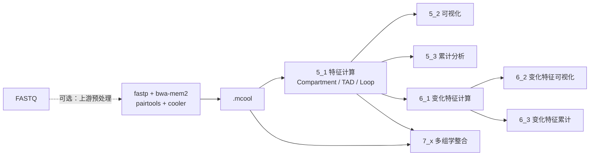

编号约定：

- **5_x**：常规分析（特征计算、可视化、累计分析）。
- **6_x**：变化特征分析（altered-feature analysis；计算、可视化、累计分析）。代码和文件名中仍保留 `differential` / `diff` 命名，文档统一使用“变化特征”。
- **7_x**：Zone-Terminal 多组学整合。

## 示例

以下命令均在仓库根目录执行。demo 数据位于 `demo/data/`，所有示例默认写入 `demo/output/`。

### 5_0 距离衰减

计算两个样本的 P(s) 距离衰减曲线，拟合并比较幂律指数 α。

- **输入**：`demo/data/hiPSC_{var,nor}_chr17.mcool`
- **关键参数**：10 kb 分辨率，最大距离 50 Mb，拟合窗口 0.2–5 Mb，`balance=False`，4 进程
- **产物**：log-log 曲线（PNG/SVG）+ α 表 + 样本对比表 + 完整 P(s) 数据

```bash
python examples/5_0_distance_decay_comparison.py
```

生产数据上通常使用 200 Mb 最大距离、0.5–5 Mb 拟合窗口；这些参数在脚本顶部修改。

<p align="center">
  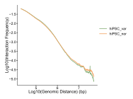
</p>

### 5_1 常规分析

从 `.mcool` 计算三类特征：

| 特征 | 分辨率 | 方法 | 主要产物 |
|---|---|---|---|
| Compartment | 100 kb | 按臂特征分解 + GC 校正 + QC | `eigenvector.*.100k.tsv`、`gc_cov.100k.tsv`、`compartment_qc.*.tsv` |
| TAD | 10 kb | insulation + Otsu 阈值 + 3 个窗口（50/100/500 kb） | `*.insulation.tsv`、`*.boundaries.tsv`、`*.tads.tsv` |
| Loop | 10 kb | `pyHICCUPS` | `*.10k.loops.txt`（BEDPE 坐标列 + HiCCUPS 统计列） |

- **输入**：两个 demo `.mcool`；推荐提供 hg38 FASTA（示例通过 `CFIZZ_FASTA` 指定；如果直接调用库并传 `fasta_path=None`，GC 会置为 0.5）
- **输出目录**：`demo/output/5_1_primary_analysis_template/1_computation/`

```bash
export CFIZZ_FASTA=/path/to/hg38.fa
python examples/5_1_primary_analysis_template.py
```

说明：

- Compartment 默认 `view="arm"`，按 UCSC cytoBandIdeo 的着丝粒把染色体拆成 p/q 臂。源码运行或 `pip install -e .` 时，会自动尝试 `demo/data/hg38.cytoBand.ideo.txt.gz`；普通安装或该文件不存在时，请设置 `CFIZZ_CYTOBAND`，否则退回整染色体视图。
- Loop 步骤需要 `pyHICCUPS`。
- Hi-C 分析对 CPU、内存和磁盘要求较高，建议在服务器或计算节点上运行；示例中的 `NPROC=26` 可按机器调整。

#### 从 FASTQ 开始（可选）

如果手上只有 FASTQ，先用 `src/cfizz/preprocessing/` 完成上游：

```text
FASTQ → fastp → bwa-mem2 → pairtools → cooler → .mcool → 5_1
```

对应的脚本是 `fastq2pairs.sh`、`pairs2mcool.sh` 和 `stats.py`，参数与示例见 [`src/cfizz/preprocessing/README.zh-CN.md`](src/cfizz/preprocessing/README.zh-CN.md)。已有 `.mcool` 的可以跳过这一步。

### 5_2 常规分析可视化

基于 5_1 产物，生成 4 个块的可视化（单样本、multi、quick_plot 组合）：

| 块 | 区域 | 分辨率 | 输出 |
|---|---|---|---|
| Heatmap | chr17:10–12 Mb | 10 kb | 单样本 + multi + `quick_plot_integrated` |
| Compartment | chr17 0–83 Mb（demo 覆盖范围） | 100 kb | 单样本 + multi |
| TAD | chr17:10–12 Mb | 10 kb | 单样本 + multi（叠加 100 kb insulation） |
| Loop | chr17:10–12 Mb | 10 kb | 单样本 + multi + `quick_plot_integrated` |

常用接口（以下片段假设 `samples` 和 `loop_paths` 已在脚本中定义）：

```python
from cfizz.viz.heatmap import generate_multi_heatmap
from cfizz.viz.loop import plot_multi_heatmap_with_loops
from cfizz.api.integrated import quick_plot_integrated, GenomeRange

# 多样本热图
generate_multi_heatmap(
    file_paths=list(samples.values()),
    sample_names=list(samples.keys()),
    chrom="chr17", resolution=10_000,
    start_pos=10_000_000, end_pos=12_000_000,
    output_dir="demo/output/.../heatmap/multi",
    balance=False, cmap="Reds",
)

# 多样本 Loop 标注
plot_multi_heatmap_with_loops(
    mcool_paths=list(samples.values()),
    loops_paths=list(loop_paths),
    output_path="demo/output/.../loop/multi/loops_multi",
    sample_names=list(samples.keys()),
    chrom="chr17", start=10_000_000, end=12_000_000,
    resolution=10_000, loop_color="blue", loop_size=8,
    plot_size=4,
)

# 快速热图（如需 TAD 边界 / Loop 叠加，
# 在 hics 中加 insulation_path / window_size / loops_path）
quick_plot_integrated(
    hics=[{"file": p, "name": n, "balance": False,
           "resolution": 10_000, "triangle_ratio": 1.0}
          for n, p in samples.items()],
    region=GenomeRange("chr17", 10_000_000, 12_000_000),
    output="demo/output/.../loop/quick_plot_integrated/quick_plot_integrated",
    n_tracks=0, width_cm=6, dpi=3000,
)
```

```bash
python examples/5_2_primary_analysis_visualization.py
```

<p align="center">
  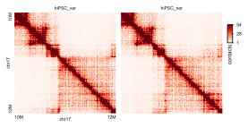
</p>

<p align="center"><sub>Heatmap multi（chr17:10–12 Mb，10 kb）</sub></p>

<p align="center">
  
</p>

<p align="center"><sub>Compartment multi（chr17:0–83 Mb，100 kb）</sub></p>

<p align="center">
  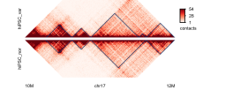
</p>

<p align="center"><sub>TAD multi（chr17:10–12 Mb，蓝色边界）</sub></p>

<p align="center">
  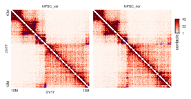
</p>

<p align="center"><sub>Loop multi（chr17:10–12 Mb，蓝色标注）</sub></p>

### 5_3 累计分析

基于 5_1 产物，生成 4 类累计图（每类 3 张：两个样本 + multi）：

| 分析 | 输入 | 关键参数 | 产物 |
|---|---|---|---|
| Saddle | 5_1 eigenvector | 100 kb、`n_bins=98`、vmin/vmax=±1 | `saddle/*/` |
| TAD linear | 5_1 boundaries | 10 kb、flank 300 kb、top 1000、mean | `tad_pileup/*/` |
| TAD O/E | boundaries + per-sample P(s) | `log2(obs/exp)`、coolwarm、±1 | `tad_oe_pileup/*/` |
| APA O/E | 5_1 loops + per-sample P(s) | median、linear、flank 70 kb、0.5–2.0 | `apa_oe/*/` |

图中展示 Saddle、TAD O/E、APA O/E；TAD linear 见产物目录 `tad_pileup/`。

常用接口（以下片段假设 `samples`、`boundaries_a/b`、`loops_a/b` 已定义）：

```python
from cfizz.viz.pileup import plot_multi_tad_boundary_pileup
from cfizz.analyze.oe import compute_expected_cis_per_sample
from cfizz.api.integrated.apa_pileup import compute_apa_oe_pileup_multi

# TAD O/E pileup
expected = compute_expected_cis_per_sample(samples, resolution=10_000, nproc=8)
plot_multi_tad_boundary_pileup(
    mcool_paths=list(samples.values()),
    boundaries_list=[boundaries_a, boundaries_b],
    expected_dfs=expected,
    output_path="demo/output/.../tad_oe_pileup/multi/tad_oe_pileup_multi",
    sample_names=list(samples.keys()),
    flank=300_000, resolution=10_000,
    color_scale="log2", cmap="coolwarm", vmin=-1, vmax=1,
    method="mean", balance=True,
)

# APA O/E
compute_apa_oe_pileup_multi(
    mcool_paths=list(samples.values()),
    loops_paths=[loops_a, loops_b],
    expected_dfs=expected,
    output_path="demo/output/.../apa_oe/multi/apa_oe_multi",
    sample_names=list(samples.keys()),
    flank=70_000, resolution=10_000,
    method="median", color_scale="linear",
    cmap="coolwarm", vmin=0.5, vmax=2.0,
    cbar_label="median obs/exp",
)
```

```bash
python examples/5_3_primary_analysis_pileup.py
```

<p align="center">
  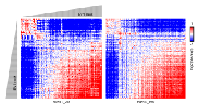
</p>

<p align="center">
  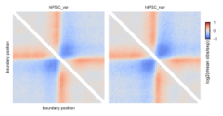
</p>

<p align="center">
  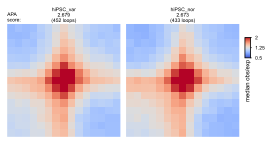
</p>

### 6_1 变化特征计算

基于 5_1 产物，对两个样本做三类变化特征分析。核心思路是**临近匹配 + 阈值分类**，而不是同源匹配：

- **Compartment**：按 `chrom/start/end` 严格合并 → `Stable_A` / `Stable_B` / `A_to_B` / `B_to_A`
- **TAD 边界**：KDTree 一维双向配对 → `Stable_boundary` / `Boundary_shift` / `Unique_boundary`
- **Loop**：先按 HiCCUPS `q_product < 0.01` 预过滤，再做 KDTree 二维锚点对匹配 → `Stable` / `Unique`（`Unique` 对应样本特有，即 gain / lost）

> 代码与文件名中仍保留 `differential` / `diff` 命名；本文档统一称为“变化特征”。

产物目录：

```text
demo/output/5_1_primary_analysis_template/4_differential/hiPSC_var--hiPSC_nor/
├── compartment/
│   ├── compartment_hiPSC_var--hiPSC_nor_diff.tsv
│   ├── compartment_hiPSC_var--hiPSC_nor_scatter.png/svg
│   └── compartment_plot_data.tsv
├── tad_boundary/{5b,10b,50b}/
│   ├── hiPSC_var_vs_hiPSC_nor_boundary_classification_final.tsv
│   ├── hiPSC_var_vs_hiPSC_nor_{window}_pairing1/2.tsv
│   ├── tad_hiPSC_var_hiPSC_nor_{window}_stacked_bar.png/svg
│   └── tad_plot_data.tsv
└── loops/
    ├── 1_1_hiPSC_var_unique_loops.tsv
    ├── 1_1_hiPSC_nor_unique_loops.tsv
    ├── 1_1_hiPSC_var_stable_loops.tsv
    ├── 1_1_hiPSC_nor_stable_loops.tsv
    ├── hiPSC_var_pairing.tsv
    ├── hiPSC_nor_pairing.tsv
    ├── loops_hiPSC_var_hiPSC_nor_stacked_bar.png/svg
    └── loops_plot_data.tsv
```

```python
from cfizz.analyze.compartment import analyze_single_comparison

analyze_single_comparison(
    comparison="hiPSC_var--hiPSC_nor",
    output_root="demo/output/.../4_differential/hiPSC_var--hiPSC_nor",
    run_mode="all",                 # all / compute / plot
    control_e1_path=control_eig,
    treatment_e1_path=treatment_eig,
)
```

```bash
python examples/diff/6_1_differential_compute.py
```

<p align="center">
  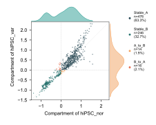
</p>

<p align="center">
  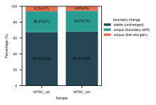
</p>

<p align="center">
  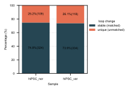
</p>

### 6_2 变化特征可视化

读取 6_1 结果，为变化特征区域单独出图：

- **Compartment**：`A_to_B` / `B_to_A`，复用 5_2 的 O/E 矩阵（demo 中仅生成了 chr17，因此仅限 chr17）
- **TAD**：`Unique_boundary` / `Boundary_shift`，3 个窗口
- **Loop**：`gain` / `lost`（来自 6_1 的 `Unique` loops），每个 loop 单独画
- 每类最多 5 张（`MAX_PER_TYPE`）

```text
4_differential/hiPSC_var--hiPSC_nor/viz/
├── compartment/{A_to_B,B_to_A}/
├── tad_boundary/{5b,10b,50b}/{Unique_boundary,Boundary_shift}/
└── loops/{gain,lost}/
```

```bash
python examples/diff/6_2_differential_visualization.py
```

<p align="center">
  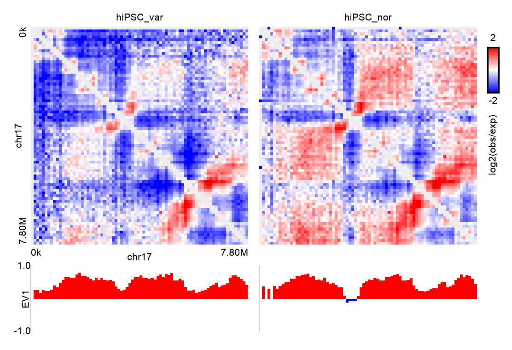
</p>

<p align="center"><sub>B_to_A 示例：chr17:0–7.8 Mb（变化较明显）</sub></p>

<p align="center">
  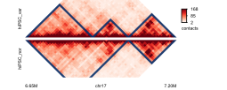
</p>

<p align="center">
  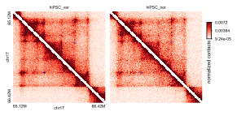
</p>

### 6_3 变化特征累计

把 6_1 的 altered loops / boundaries 放在两个样本的 mcool 上做累计对比：

- **Loop APA**：同一份 `gain` 或 `lost` loops，分别在两个样本上做 O/E APA（median + linear）
- **TAD pileup**：同一份 altered boundaries，分别在两个样本上做 O/E pileup（log2 + coolwarm），窗口 5b/10b/50b
- **发布配置**：4 cm 单图宽、3000 dpi、APA 用 median + linear、TAD 用 log2 + coolwarm

```text
4_differential/hiPSC_var--hiPSC_nor/viz/
├── loops_apa/{gain,lost}/loops_apa_*.png/svg
└── tad_pileup/{gain,lost}/{5b,10b,50b}/tad_pileup_*.png/svg
```

```bash
python examples/diff/6_3_differential_pileup.py
```

<p align="center">
  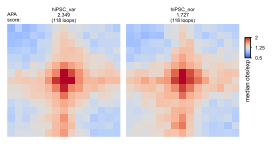
</p>

<p align="center">
  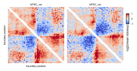
</p>

### 7_1 多组学整合

单基因多组学整合图：Hi-C + GTF + enhancer BED + 8 条 BigWig。

- **区域**：chr17:75,400,000–76,340,000（940 kb）
- **基因**：FOXJ1
- **轨道**：GTF → enhancer BED → ATAC × 2 → H3K27ac × 2 → CTCF × 2 → RNA × 2
- **产物**：`demo/output/7_1_multi_omics_integrated/`

```bash
python examples/integrated/7_1_multi_omics_integrated.py
```

核心接口是 `quick_plot_integrated`：

```python
from cfizz.api.integrated import quick_plot_integrated, GenomeRange

quick_plot_integrated(
    hics=[
        {"file": "sample_a.mcool", "name": "A", "balance": True,
         "resolution": 10_000, "triangle_ratio": 1.0,
         "insulation_path": "tad/1_0.sample_a.10000.insulation.tsv",
         "window_size": 100_000},
        {"file": "sample_b.mcool", "name": "B", "balance": True,
         "resolution": 10_000, "triangle_ratio": 1.0,
         "flip_vertical": True,
         "loops_path": "loops/sample_b.10k.loops.txt"},
    ],
    tracks=[
        {"file": "genes.gtf", "gtf_style": "flybase", "labels": True},
        {"file": "enhancers.bed", "color": "purple", "name": "Enhancers"},
        {"file": "CTCF.bw", "color": "#264653", "name": "CTCF"},
        {"file": "RNA.bw", "color": "#E76F51", "name": "RNA"},
    ],
    region=GenomeRange("chr8", 127_235_000, 128_243_000),
    output="out/figure",
    width_cm=6,
    dpi=3000,
)
```

<p align="center">
  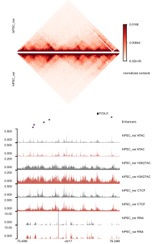
</p>

### 7_2 / 7_3 扩展示例

- `examples/integrated/7_2_log2_tracks.py`：把最后两条轨道（RNA × 2）替换为 log2 fold-change（ATAC、RNA），用于展示变化信号。
- `examples/integrated/7_3_multi_gene.py`：把单基因 GTF 换成 19 个基因的合并 GTF，用于展示多基因区域。

两者与 7_1 使用同一套 demo 数据，运行方式相同：

```bash
python examples/integrated/7_2_log2_tracks.py
python examples/integrated/7_3_multi_gene.py
```

## 案例展示

README 顶部是一张来自真实数据的案例图，用于展示 cfizz 在完整数据上的效果。它**不是**内置 demo 的输出。

- **数据**：H1-hESC vs HFFc6（4DN）
- **位点**：chr8:127,235,000–128,243,000（*MYC* 区域，10 kb）
- **内容**：两个样本的半三角 Hi-C、TAD 边界、Loop 弧线、7 个基因的 GTF、H1ESC enhancer BED、5 类组学 × 2 样本（CTCF / ATAC / H3K27ac / H3K4me3 / RNA）
- **输出**：3000 dpi PNG（12,992 × 23,149 px，7.0 MB）+ 矢量 SVG（2.9 MB，热图内嵌 2000 dpi 栅格）；版式参数 `width_cm=8`，可按需调整
- **Hi-C 数据 accession**：H1-hESC `4DNFI82R42AD`，HFFc6 `4DNFIAVXXO55`
- **说明**：该图由配套手稿中的生产脚本生成；完整数据清单与复现说明将在论文投稿时补充

内置 demo 使用的是 chr17 小数据（15 MB、覆盖度较浅、变化较弱），目的是让用户快速跑通流程，而不是展示生物学变化。两者在 README 中明确区分：

- **Examples**：全部基于 demo，用户可以直接复现。
- **Case study**：基于真实数据，用来说明工具在完整数据上的能力。

## Demo 数据

`demo/data/` 共约 15 MB：

```text
demo/data/
├── hiPSC_nor_chr17.mcool        # 5.8 MB，10 kb + 100 kb
├── hiPSC_var_chr17.mcool        # 5.9 MB，10 kb + 100 kb
├── 19 个单基因 GTF              # FOXJ1 等
├── concordant_enhancer.chr17_75.4-76.34M.bed
├── 8 条样本 BigWig              # ATAC / H3K27ac / CTCF / RNA × 2
├── 2 条 log2 BigWig             # ATAC / RNA 变化轨道
└── hg38.cytoBand.ideo.txt.gz    # Compartment 按臂拆分
```

demo 的定位：

- 可以在工作站或 CI 中快速跑通全部示例；
- 覆盖度较浅、变化较弱，不适合用来评估灵敏度或做生物学结论；
- 需要真实数据效果时，请参考上方的案例展示。

## Demo 输出与完整运行顺序

```text
demo/output/
├── 5_0_distance_decay_comparison/
│   └── 7_distance_decay/
├── 5_1_primary_analysis_template/
│   ├── 1_computation/           # 5_1
│   ├── 2_visualization/         # 5_2
│   ├── 3_pileup/                # 5_3
│   └── 4_differential/          # 6_x
├── 7_1_multi_omics_integrated/  # 7_1
├── 7_2_log2_tracks/             # 7_2
└── 7_3_multi_gene/              # 7_3
```

推荐顺序：

```bash
# 1. 距离衰减（独立）
python examples/5_0_distance_decay_comparison.py

# 2. 常规分析（5_2 / 5_3 / 6_x 都依赖它）
export CFIZZ_FASTA=/path/to/hg38.fa
python examples/5_1_primary_analysis_template.py

# 3. 常规分析可视化
python examples/5_2_primary_analysis_visualization.py

# 4. 常规分析累计
python examples/5_3_primary_analysis_pileup.py

# 5. 变化特征计算
python examples/diff/6_1_differential_compute.py

# 6. 变化特征可视化
python examples/diff/6_2_differential_visualization.py

# 7. 变化特征累计
python examples/diff/6_3_differential_pileup.py

# 8. 多组学整合（独立）
python examples/integrated/7_1_multi_omics_integrated.py

# 9. 多组学扩展示例（可选）
python examples/integrated/7_2_log2_tracks.py
python examples/integrated/7_3_multi_gene.py
```

依赖关系：

- `5_1` 是 `5_2`、`5_3`、`6_1` 的前置；`6_2` / `6_3` 依赖 `6_1`。
- `6_2` 还依赖 5_2 生成的 O/E 矩阵；demo 中仅包含 chr17。
- `5_1` 的 Compartment 推荐提供 FASTA；Loop 步骤需要 `pyHICCUPS`。
- `7_x` 指本仓库的 `7_1` / `7_2` / `7_3`；它们只读 demo 数据，不依赖 5_1 产物。
- `7_2` / `7_3` 为扩展示例，运行后分别生成到 `demo/output/7_2_log2_tracks/` 和 `demo/output/7_3_multi_gene/`。

## API 总览

| 模块 | 作用 | 代表函数 |
|---|---|---|
| `cfizz.analyze.compartment` | Compartment 计算与变化特征 | `process_compartment`、`analyze_single_comparison` |
| `cfizz.analyze.tad` | TAD 计算与变化特征 | `process_tads`、`analyze_single_comparison_window` |
| `cfizz.analyze.loop` | Loop 计算与变化特征 | `process_loops`、`analyze_single_comparison_loops` |
| `cfizz.analyze.oe` | O/E 与 expected | `calculate_oe_matrix`、`compute_expected_cis_per_sample`、`load_or_compute_oe_matrix` |
| `cfizz.analyze.distance` | 距离衰减 | `compute_distance_decay_per_sample`、`fit_decay_alpha_segments` |
| `cfizz.viz.heatmap` | 热图 | `generate_heatmap`、`generate_multi_heatmap`、`plot_multi_heatmap` |
| `cfizz.viz.compartment` | Compartment 图 | `plot_compartment`、`generate_multi_compartment` |
| `cfizz.viz.loop` | Loop 图 | `plot_heatmap_with_loops`、`plot_multi_heatmap_with_loops` |
| `cfizz.viz.pileup` | 累计图 | `plot_multi_tad_boundary_pileup`、`plot_multi_pileup` |
| `cfizz.viz.distance_decay_plot` | 距离衰减图 | `run_distance_decay`、`plot_distance_decay_curves` |
| `cfizz.api.integrated.quick_plot` | 整合图 | `quick_plot_integrated` |
| `cfizz.api.integrated.saddle_plot` | Saddle | `generate_single_saddle`、`generate_multi_saddle` |
| `cfizz.api.integrated.apa_pileup` | APA | `plot_multi_apa_heatmap`、`compute_apa_oe_pileup_single`、`compute_apa_oe_pileup_multi` |
| `cfizz.io` | 数据读写 | `read_cooler`、`extract_contact_matrix`、`read_loops_bedpe`、`read_tads_bed` |
| `cfizz.utils` | 坐标与区间工具 | `calc_symmetric_range`、`calc_smart_union_range`、`calc_anchor_range`、`make_loop_region_id` |
| `cfizz.preprocessing` | 可选的上游预处理 | `fastq2pairs.sh`、`pairs2mcool.sh`、`stats.py` |

更多参数与默认值请参考函数 docstring；README 只保留常用参数，避免与代码版本脱节。

## 输入数据与参考文件

| 输入 | 格式 | 用途 | 是否随仓库提供 |
|---|---|---|---|
| Hi-C 矩阵 | `.mcool`（含所需分辨率） | 全部 5_x / 6_x / 7_x | ✅ demo 提供 chr17 子集 |
| 参考基因组 | `.fa`（建议带 `.fai`） | Compartment GC 校正 | ❌ 用户自备 |
| 染色体大小 | `chrom.sizes` | 上游预处理 | ❌ 用户自备 |
| cytoBandIdeo | `.txt.gz` | Compartment 按臂拆分 | ✅ demo 提供 |
| GTF | `.gtf` | 基因轨道、多组学整合 | ✅ demo 提供单基因 GTF |
| BED | `.bed` | enhancer / ChromHMM 轨道 | ✅ demo 提供 |
| BigWig | `.bw` | ATAC / ChIP / RNA 轨道 | ✅ demo 提供 chr17 子集 |

相关环境变量：

- `CFIZZ_FASTA`：5_1 使用的参考基因组路径。
- `CFIZZ_CYTOBAND`：Compartment arm view 使用的 cytoBandIdeo 路径；源码运行或 editable 安装会尝试 `demo/data/hg38.cytoBand.ideo.txt.gz`，普通安装请显式设置，否则退回整染色体视图。

## 上游预处理

`src/cfizz/preprocessing/` 提供 3 个参数化脚本，用于从 FASTQ 生成平衡 `.mcool`：

| 脚本 | 输入 | 输出 |
|---|---|---|
| `fastq2pairs.sh` | R1/R2 FASTQ | `*.nodups.UU.pairs.gz` |
| `pairs2mcool.sh` | filtered pairs | 多分辨率 `.mcool` |
| `stats.py` | pairtools stats | 处理得率表 |

这些脚本只是 fastp / bwa-mem2 / pairtools / cooler 的参数化包装，不是强制流程。已有 `.mcool` 的用户可以完全跳过。详细参数见 [`src/cfizz/preprocessing/README.zh-CN.md`](src/cfizz/preprocessing/README.zh-CN.md)。

## 项目结构

```text
cfizz/
├── assets/figures/                 # README 使用的图片资产
├── demo/
│   ├── data/                       # 15 MB demo 输入
│   └── output/                     # demo 产物
├── examples/
│   ├── 5_0_distance_decay_comparison.py
│   ├── 5_1_primary_analysis_template.py
│   ├── 5_2_primary_analysis_visualization.py
│   ├── 5_3_primary_analysis_pileup.py
│   ├── diff/
│   │   ├── 6_1_differential_compute.py
│   │   ├── 6_2_differential_visualization.py
│   │   └── 6_3_differential_pileup.py
│   └── integrated/
│       ├── 7_1_multi_omics_integrated.py
│       ├── 7_2_log2_tracks.py
│       └── 7_3_multi_gene.py
├── src/cfizz/
│   ├── analyze/                    # compartment / tad / loop / oe / distance
│   ├── api/integrated/             # quick_plot / saddle / APA / tracks
│   ├── io/                         # cooler / BED / GTF / BigWig / paths
│   ├── preprocessing/              # 可选的上游脚本
│   ├── utils/                      # 坐标 / 区间 / BEDPE
│   ├── viz/                        # heatmap / compartment / TAD / loop / pileup
│   └── config.py
├── environment.yml
├── requirements.txt
├── pyproject.toml
├── README.md                       # 英文主文档
├── README.zh-CN.md                 # 本文件
├── CONTRIBUTING.md                 # 英文版
├── CONTRIBUTING.zh-CN.md           # 中文版
└── LICENSE
```

## 常见问题

**5_1 提示找不到 FASTA？**

设置 `CFIZZ_FASTA=/path/to/hg38.fa`，或修改脚本顶部的 `FASTA_PATH`。示例使用占位路径 `/path/to/hg38.fa`，未设置时会报错；如果直接调用库并传 `fasta_path=None`，cfizz 会把 GC 置为 0.5，仍可继续计算，但 Compartment 的 GC 校正会失效。

**5_1 的 Loop 步骤失败？**

Loop calling 依赖 `pyHICCUPS`。执行 `pip install hicpeaks` 后确认 `which pyHICCUPS` 有输出。只做 Compartment / TAD 时可以暂时注释 Loop 步骤。

**Compartment 没有按臂拆分？**

arm view 需要 cytoBandIdeo。源码运行或 editable 安装会尝试读取 `demo/data/hg38.cytoBand.ideo.txt.gz`；普通安装请设置 `CFIZZ_CYTOBAND`，否则会自动退回整染色体视图。

**demo 的图看起来变化很弱？**

这是有意为之：demo 只有 chr17、15 MB、覆盖度较浅，用于快速复现流程。真实数据效果见 [案例展示](#案例展示)。

**如何输出 3000 dpi 的出版级图？**

PNG 用 `dpi=3000`；物理尺寸用 `width_cm` / `height_cm` 控制。SVG 中的热图是内嵌栅格，默认 `svg_dpi=1000`，`quick_plot_integrated` 可通过 `svg_dpi` 调整。需要注意：`imshow` 类图（如 compartment）的内嵌栅格受矩阵分辨率限制，提高 dpi 不会增加真实像素；这类图更适合用 PNG 或矢量方式展示。

**内存或 CPU 不够？**

把示例中的 `NPROC` 从 26 降到 4–8；数据量和分辨率越大，内存占用越高。

## 引用、贡献与许可

- **引用**：配套手稿准备中。当前可引用本仓库：`https://github.com/Cuixiaojian21/cfizz`。案例数据的完整 accession 清单将在论文投稿时补充。
- **贡献**：开发环境、代码风格、示例规范与 PR 流程见 [`CONTRIBUTING.zh-CN.md`](CONTRIBUTING.zh-CN.md)。
- **许可**：MIT，详见 [`LICENSE`](LICENSE)。
